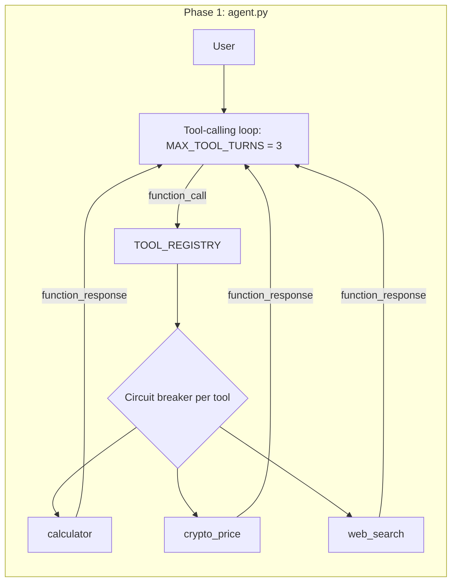
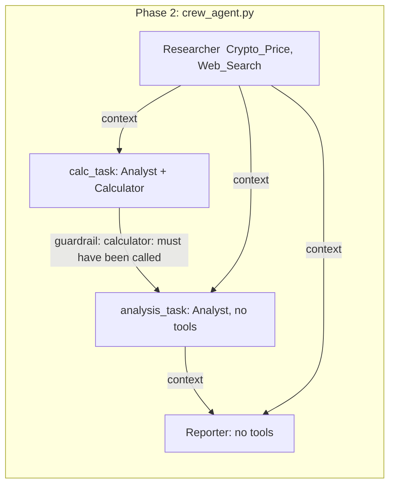

# Crypto Research Agents

A tool-calling agent built from scratch in plain Python (Gemini function calling), then extended into a three-agent CrewAI pipeline that researches a cryptocurrency and writes a short report.

The main goal of this project was not the report itself. It was to see how LLM agents fail when they use tools, and to build checks that catch those failures. See [Failure Analysis](#failure-analysis).

## What it does

- **Phase 1 – `agent.py`:** a CLI chatbot with a hand-written tool-calling loop. Three tools: a calculator, a crypto price lookup (CoinGecko), and web search (Tavily). Multi-turn history, retries, and a per-tool circuit breaker.
- **Phase 2 – `crew_agent.py`:** the same tools wrapped for CrewAI and used by three agents running in sequence: Researcher → Analyst → Reporter. Output is a markdown report.

## Architecture





## Quick start

```bash
python -m venv .venv
# Windows: .venv\Scripts\activate    macOS/Linux: source .venv/bin/activate
python -m pip install -r requirements.txt
```

Create a `.env` file (never commit it):

```
GEMINI_API_KEY=...
TAVILY_API_KEY=...
```

Run:

```bash
python agent.py        # interactive CLI agent
python crew_agent.py   # three-agent report on bitcoin
```

Model: `gemini-3.1-flash-lite`. CrewAI 1.15.

## Design decisions

- **AST-based calculator instead of `eval`.** The expression comes from a model, so it is parsed and only numbers and `+ - * /` are evaluated.
- **One `ToolExecutionError` for every tool failure.** The agent loop does not need to know each tool's exception types, and error text goes back to the model as the tool result.
- **Retry scope is the network call only.** Each tool has a private `_fetch_*` function with a tenacity decorator (retry on `RequestException`, 3 attempts, exponential backoff 1–8 s, `reraise=True`). Input errors such as an unknown coin id are not retried.
- **Circuit breaker per tool, not per session.** Three consecutive failures disable that tool for 300 s. One broken API does not take the other tools down.
- **Always append the model's response to the history before branching on `function_call`.** Without this, Gemini mixed answers from different turns (a bug I hit and fixed).
- **Calculator is given only to the Analyst; web search only to the Researcher.** Collection and analysis are separate steps, so a wrong number can be traced to one of them.
- **Sequential process.** Each step depends on the previous step's output, so there is nothing to run in parallel.

## Failure Analysis

Most of the work in phase 2 was finding and containing agent failures. These are from my own runs of the same prompt, so they show what can happen, not how often.

| # | What happened | How I noticed | What I changed |
|---|---|---|---|
| 1 | The Researcher turned "17 hours ago" into a calendar date (`2025-05-13`) when the real date was October 2026. "Use an absolute date" conflicted with "do not guess", and the agent followed the first. | Read the output against the search results. | Told the agent to copy the time text exactly as shown and never convert it. Dates then came back as the original text. |
| 2 | The Analyst said "using the calculator tool" but no tool call appeared in the log. | The log had no `Tool Execution` block for the Analyst. | Made the instruction stricter ("MUST use the Calculator"). |
| 3 | After that, the Analyst printed `Expression: 83000 - 82238 / Result: 762` in the format I had asked for, again without calling the tool. The number was correct, but the evidence was invented. | Compared the printed expressions with the log. | Added a guardrail (see below). |
| 4 | The guardrail blocked the Analyst on all four attempts (first try + 3 retries) and the run stopped with an exception. Retry feedback did not change the behaviour. | Guardrail log. | Treated the guardrail as a detector that stops the pipeline, not as a fixer. |
| 5 | A standalone test showed the tool itself worked when the task was only "call the Calculator with this expression". | `check_calc.py` run. | Moved the calculation into its own task (`calc_task`) so calling the tool is its whole job. The guardrail then passed on the first attempt and the two logged calls matched the reported numbers. |

**How the guardrail works.** The calculator tool appends every real call to a list. The task guardrail fails if that list is empty. The agent cannot fake this, because its text output never touches the list.

## Limitations

- The guardrail checks that the calculator was called, not that the final text uses its results. In one run the Analyst wrote that \$83,000 was flagged as a "critical level", which was not in the Researcher's output (the source text mentioned \$81,300).
- Relative times such as "about 2 hours ago" are relative to when the search result was collected, not to now. They are passed along as text and are not a reliable time axis.
- The circuit breaker from phase 1 is not used in the CrewAI pipeline.
- There is no evaluation harness yet. The failure counts above come from a handful of manual runs.
- Further improvements (What could be done next?): automated tests in CI, Docker, retrieval over a vector store.

## Project structure

```
agent.py            Phase 1 CLI agent (hand-written tool loop)
circuit_breaker.py  Per-tool circuit breaker
calculator.py       AST calculator + ToolExecutionError + tool declaration
crypto_price.py     CoinGecko price lookup with retry
websearch.py        Tavily search with retry
crew_tools.py       CrewAI wrappers; records real calculator calls
crew_agent.py       Researcher -> Analyst -> Reporter pipeline
check_calc.py             Manual check that the Calculator tool is really called
check_circuit_breaker.py  Manual check of the circuit breaker
```
